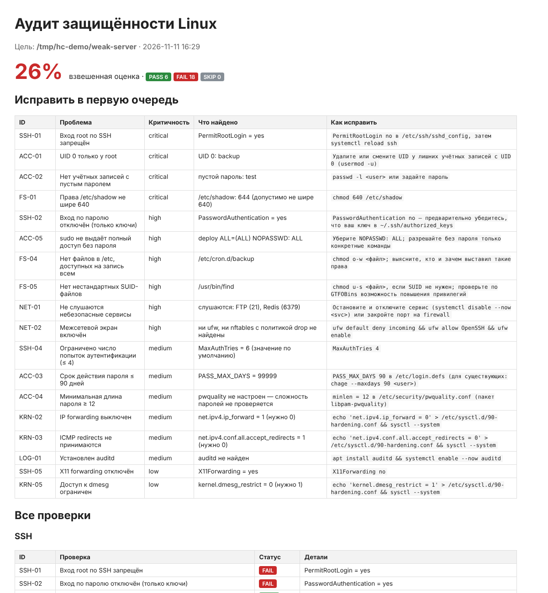

# harden-check — аудит защищённости Linux-сервера

Сканер конфигурации Linux: 24 проверки по SSH, учётным записям, правам на файлы, параметрам ядра, сетевым сервисам и журналированию. Для каждой проблемы выдаёт, что именно найдено и какой командой это исправить. Работает **только на чтение** (это покрыто тестом). Может проверять как живую систему, так и смонтированный образ или бэкап.



## Пример

| Сервер | Оценка | Найдено проблем |
| --- | --- | --- |
| `weak-server` (демо: настройки по умолчанию + типичные ошибки) | 26% | 18 |
| `hardened-server` (демо: после исправлений) | 100% | 0 |

```
[FAIL] SSH-01  Вход root по SSH запрещён — PermitRootLogin = yes
[FAIL] ACC-01  UID 0 только у root — UID 0: backup
[FAIL] ACC-05  sudo не выдаёт полный доступ без пароля — deploy ALL=(ALL) NOPASSWD: ALL
[FAIL] FS-05   Нет нестандартных SUID-файлов — /usr/bin/find
[FAIL] NET-01  Не слушаются небезопасные сервисы — слушаются: FTP (21), Redis (6379)
...
Оценка: 26%  (FAIL 18, PASS 6)
```

## Проверки

| Категория | ID | Что проверяется |
| --- | --- | --- |
| SSH | SSH-01…05 | PermitRootLogin, PasswordAuthentication, PermitEmptyPasswords, MaxAuthTries ≤ 4, X11Forwarding |
| Учётные записи | ACC-01…05 | лишние UID 0, пустые пароли, PASS_MAX_DAYS ≤ 90, minlen ≥ 12 в pwquality, `NOPASSWD: ALL` в sudoers |
| Файлы | FS-01…05 | права на shadow/passwd/sudoers, файлы в /etc с записью для всех, нестандартные SUID-бинарники |
| Ядро | KRN-01…05 | ASLR, ip_forward, accept_redirects, tcp_syncookies, dmesg_restrict |
| Сеть | NET-01…02 | слушающие FTP/Telnet/rsh/Redis/MongoDB… (по `/proc/net/tcp`), включён ли ufw/nftables |
| Журналирование | LOG-01…02 | auditd, наличие auth.log/journald |

Проверки опираются на рекомендации CIS Benchmarks для Linux и типовые находки при пентестах (SUID на `find` — классический путь к root по GTFOBins).

### Тонкости, которые учтены

- **sshd** берёт *первое* значение опции, а файлы `sshd_config.d/*.conf` подключаются до основного конфига. Блоки `Match` не влияют на глобальные настройки. Если опция не задана, используется её значение по умолчанию, и это помечается в отчёте.
- **sysctl** — сначала читается живое значение из `/proc/sys`, затем конфиги; `/etc/sysctl.conf` применяется последним.
- Отсутствующий файл даёт `SKIP`, а не `FAIL`, и не влияет на оценку.
- Оценка взвешенная: critical = 10, high = 6, medium = 3, low = 1.

## Запуск

```bash
pip install -r requirements.txt

sudo python -m hardencheck.cli                         # живая система (root нужен для /etc/shadow)
python -m hardencheck.demo -o demo                     # демо-образы
python -m hardencheck.cli --root demo/weak-server -o out
python -m hardencheck.cli --fail-under 80              # для CI: код 1, если оценка < 80%
python -m pytest -q                                    # 22 теста
```

Результаты: `out/report.html` (для людей) и `out/report.json` (для автоматизации).

## Как устроено

Каждая проверка — функция с декоратором `@check(id, категория, название, критичность, рекомендация)`, которая возвращает статус и детали. Все пути считаются относительно `--root`, поэтому тесты собирают «серверы» во временных каталогах с нужными правами.

```python
@check("ACC-01", "Учётные записи", "UID 0 только у root", "critical", "usermod -u ...")
def uid0(ctx):
    extra = [r[0] for r in _passwd(ctx) if r[2] == "0" and r[0] != "root"]
    return (FAIL, "UID 0: " + ", ".join(extra)) if extra else (PASS, "только root")
```

## Стек

Python 3.11+ (только стандартная библиотека + Jinja2 для отчёта), pytest

## Что можно добавить

- Проверки по требованиям ФСТЭК (приказ № 17) и ГОСТ Р 57580 для финансовых организаций.
- Аудит Docker (привилегированные контейнеры, монтирование docker.sock).
- Режим сравнения двух отчётов, чтобы видеть, что изменилось после исправлений.
